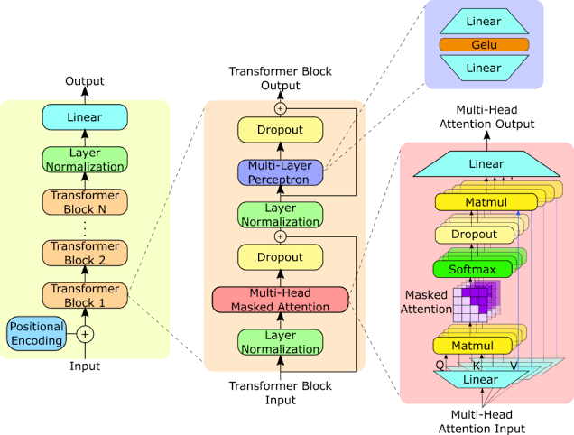

# LLM from scratch

Estoy intentando programar un LLM desde cero con PyTorch. Parto únicamente de este esquema y voy intentando llevar cada pieza a código para entender cómo funciona.

La idea es mantener la arquitectura de GPT-2: un transformer decoder con masked self-attention y embeddings posicionales aprendidos clásicos.

Por ahora llevo unas primeras pruebas de attention en [Transformer.ipynb](Transformer.ipynb): embeddings, proyecciones Q, K y V, scaled dot-product attention y una conexión residual. Todavía falta separar las cabezas y añadir la máscara causal. Está todo bastante verde y lo iré construyendo poco a poco.

Lo que tengo en mente:

- Terminar la attention multi-head con su máscara causal.
- Crear el tokenizer y montar el backbone completo.
- Entrenarlo y generar texto.
- Implementar KV cache para la generación.
- Más adelante, meterme con fine-tuning y RL.

Quiero recorrer todo el proceso manteniendo esa arquitectura como base. De momento, work in progress.
